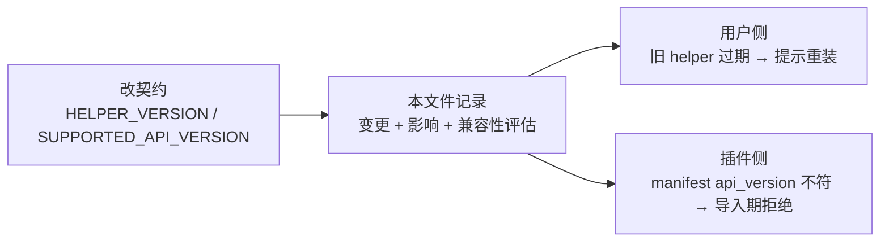

# CHANGELOG

> 本文件回答一个问题：**某次改动之后，外部插件作者与已经装盘的用户分别会撞到什么**。
> 规矩在 §5（版本门与 CHANGELOG 约定）：改 `SUPPORTED_API_VERSION`
> / `SUPPORTED_CONFIG_SCHEMA_VERSION` 属破坏性变更，须记录变更与影响范围、
> 评估对所有外部插件的兼容性、同步更新 ADR-2 与工作项状态。
>
> **写什么**：版本门（契约版本／依赖契约的行为）的每一次变动，外加一条「谁受影响」。
> **不写什么**：纯内部重构的流水账（拆包、改名、死代码清理），除非它改到了插件看得见的那一面。
> **日期**：helper 变更史自 2.15.0 起逐条记日期，更早条目原文未记，此处留空而不是猜。

## 1. 规矩：两道版本门各管谁

两道门走的是两条路，别混：

| 门 | 常量与位置 | 管的是 | 不匹配时的后果 |
|---|---|---|---|
| 契约版本（插件侧） | `SUPPORTED_API_VERSION = 3`（`src/barkit/contribution/points.py:22`） | 外部／内部插件的契约面 | 读 manifest 即拒（`src/barkit/core/exporter.py:139`），导入期给可读错误，不崩溃 |
| 契约版本（守护侧） | `HELPER_VERSION`（`src/barkit/capabilities/helper/version.py:252`，当前 2.20.2） | helper 与 app 之间的线格式 | 整份意图拒绝 ＋ 冻结（`src/barkit/capabilities/helper` 的 validate 分支） |
| 配置格式版本 | `SUPPORTED_CONFIG_SCHEMA_VERSION = 1`（`src/barkit/core/config/consts.py:30`） | 用户配置文件 | `barkit doctor` 报 schema 版本不符 |

本文件下面第 2 节按时间倒序列 helper 那一侧的历次版本门（素材来自 helper 变更史），
第 3 节单独写**外部插件**受哪些改动影响 —— 那一条与 helper 版本门无关。

## 2. 守护侧版本门（HELPER_VERSION）

「谁受影响」这一列的含义：`须重装` 表示装了旧守护的用户必须重装才拿到新行为；
`外部插件` 表示普通第三方插件是否受波及（判断依据见第 3 节的口径）。

| 版本 | 日期 | 变的是什么 | 谁受影响 |
|---|---|---|---|
| 2.20.2 | 2026-10-12 | **hev 模板显式钉死 `socks5.udp: 'tcp'` ＋ 保活轮 utun 缓存优先**。① 模板 socks5 段补 `udp: 'tcp'`：hev 只在取值恰为 `'udp'` 时置 `udp_in_udp=1`（`hev-config.c:251`），其余 —— 含键缺失，靠 `memset` 归零 —— 都落到 FWD UDP（UDP-in-TCP，CMD=0x05，UDP 报文封进已有 SOCKS5 TCP 连接）⇒ **本键与不写行为逐字节相同**，加它是把模式显式钉死、不让上游默认值随版本漂移（上游 README 把 `udp: 'udp'` 排成未注释样例，易被误读成默认值）。② `_ensure_tunnel` 保活轮的 utun 由「每轮先全量扫（`ifconfig -l` ＋ 每个 utun 各一次，常态 5-10 fork）」改为缓存优先：命中只花单次 `ifconfig <名>` 验「接口在且地址是隧道地址」，失效才回退全量扫并回填（`tunlifecycle.py` ＋ `tunshell._utun_exists`）。**线格式未变（契约仍 8）** | 须重装；外部插件不受影响 |
| 2.20.1 | 2026-10-09 | **「恢复 DHCP」那条路也记账**（2.20.0 的补漏）。那本「网卡 → 网关」账原本只挂在**一轮周期**上，而用户当场按下的 `route.renew` 走的是**一次性命令**那条路（`ops._apply_op`）—— 它同样读租约、同样固化，却不更新那本账。真实时序必然踩空：场景命中 ⇒ 网卡被切成 Manual ⇒ 周期那条路从此读不到租约 ⇒ 账恒空 ⇒ 面板一直报「未取到网关」、留空的那几行永远不动，而回执写着「已恢复 DHCP 并固化」。现在命令那条路写同一栏 `iface_gateway` 并调**同一个**账函数；那三个账函数随之下沉到 `converge`（命令侧不该反向依赖「把一轮跑完」那个模块）。**线格式未变（契约仍 8）** | 须重装；外部插件不受影响 |
| 2.20.0 | 2026-10-09 | **意图契约 7 → 8：`rules[].gateway` 允许空串**。空串的语义是「这个下一跳由 helper 从本场景固化那块网卡上取」——**只对带 `pin` 的 `net` 成立**（`validate._pins_lease`）；取到过就记进顶层 `net_gateways`（跨守护重启靠快照带回），取不到时该条**既不叠也不撤**并回显 `gateway_src: "none"`。同批 `net` 段多一栏 `iface_gateway`（本场景给这块网卡定下的网关）、每条规则回显多一栏 `gateway_src`（`rule` / `iface` / `none`）。旧语义是「有目标必须给网关」，故本条只把今天**非法**的配置救活，合法配置的含义一个字节没变。⚠️ 两侧须同批：app 侧 `INTENT_VERSION` 同步 7 → 8 | 须重装；外部插件不受影响 |
| 2.19.2 | 2026-10-09 | hev 隧道 `limit-nofile` 512 → 2048：512 只够约 505 条会话（本端每会话 1 fd，本地侧走 tun 不占 fd），比同段 `max-session-count`（1024）更早生效 ⇒ 会话上限永远够不着、配置自相矛盾，且撞线后 hev 开不出新 socket 而失败不显眼。2048 与 iPad 侧 server 的 `limit-nofile` 对齐（那边每会话 2 fd，约 1020 条连接，是两端最紧的一环） | 须重装；外部插件不受影响 |
| 2.19.1 | 2026-10-09 | hev 隧道读写超时 30s → 300s：旧键 `read-write-timeout: 30000` 换成 `tcp-read-write-timeout: 300000` ＋ `udp-read-write-timeout: 60000`（均取上游默认）。30s 是上游默认的 1/10，会把推送／WebSocket 这类安静的长连接当空闲会话收割，每收一条客户端就重连一条 | 须重装；外部插件不受影响 |
| 2.19.0 | 2026-10-06 | 路由规则加可选 `off_destinations`（本条里**要撤**的那几个目标）＋ 收敛改成逐目标判加还是撤。一位 `enabled` 装不下「同一条里 A 加、B 撤」；同批意图契约 6 → 7 | 须重装，两侧必须同批升级；外部插件不受影响 |
| 2.18.0 | 2026-09-30 | 回滚保险窗复活（窗口上沿改为 `max(20s, 节拍+10s)`，`applied_at` 只记真写那一轮）＋ 事实推送按内容去重 | 须重装；外部插件不受影响 |
| 2.17.1 | 2026-09-30 | 修「已固化 IP 跨重启卡在失败」：网卡已是 Manual 且无租约时拿当前配置当租约替身 | 须重装（装上下一轮自愈）；外部插件不受影响 |
| 2.17.0 | 2026-09-29 | 通信通道从文件换成本机会话：四类消息（intent/op/subscribe+push）取代四份文件＋敲门 | 须重装，两侧必须同批升级；外部插件不受影响 |
| 2.16.0 | 2026-09-29 | 「命令」与「策略」拆开（`ops` 独立通道）；`tunnel.json` 升 v2、去掉 `link_up`／`ignore_link` | 须重装；读 helper 状态的插件需跟着改 |
| 2.15.0 | — | 意图契约版本**真锁**：文件写的 ≠ `INTENT_VERSION`（缺位也算）⇒ 整份拒绝＋冻结 | 须重装（更严）；外部插件不受影响 |
| 2.14.0 | 2026-09-18 | `net.pin` 新增 `gateway_from_lease` / `dns_from_lease`，与写死值互斥 | 契约变更须重装；外部插件不受影响 |
| 2.13.0 | — | `handback_dns` 进契约（交还网卡时是否连 DNS 一起交回） | 契约变更须重装；外部插件不受影响 |
| 2.12.0 | — | 网卡配置作用域（`net` / `handback`）、baseline 快照、20s 回滚窗口 | 契约与行为变更须重装；外部插件不受影响 |
| 2.11.2 | — | `helper.log` 按 1 MiB 轮转（`.log.1` 保留一份） | 行为新增须重装；外部插件不受影响 |
| 2.11.1 | — | 落盘写入入口收口，绕开 `_open_nofollow` 的 tmp 改成 CWE-59 面 | 行为等价，安全收紧；外部插件不受影响 |
| 2.11.0 | — | 启动／执行前完整性自检（`manifest.json` 基线 ＋ `codesign --verify`） | 契约与安装形态变更须重装；外部插件不受影响 |
| 2.10.0 | — | hosts 期望态 v1 → v2（块正文由 app 渲染），helper 侧删掉解析链 | 契约变更须重装；外部插件不受影响 |
| 2.9.0 | — | 路由匹配决策迁回 app 侧，`routes.json` 升 v2（带 `apply` / `trigger_matched`） | 契约变更须重装；外部插件不受影响 |
| 2.8.0 | — | helper 由硬编码三套 cycle 改成 task 表驱动通用执行器 | 原语集合变更须重装；外部插件不受影响 |
| 2.7.0 | — | helper 迁成整目录包，`com.barkit.routed` → `com.barkit.helper` | 安装形态变更须重装；外部插件不受影响 |
| 2.6.3 | — | 删用户域 hev 回退（本地提权面）；`tunnel.json` 的 `actions` 降级为固定 `wifi` | 安全热修；外部插件不受影响 |
| 2.6.2 | — | 保活轮复检上游 SOCKS，断开即拆隧道（防流量黑洞） | 行为改进；外部插件不受影响 |
| 2.6.1 | — | DNS 劫持诚实化：目标无活跃 IPv4 时不劫持，按 resolver 实际采纳上报 | 行为改进；外部插件不受影响 |
| 2.6 | — | 新增 hosts_guard（`/etc/hosts` 托管块） | 新增能力；外部插件不受影响 |
| 2.5 | — | 新增 `force_apply`（面板「真手动」开关） | 内部行为；外部插件不受影响 |
| 2.4 | — | 修 `mapdns` 缺 `address` 键 → DNS 拦截被静默禁用 | 缺陷修复；外部插件不受影响 |
| 2.3 | — | 劫持默认改为旁路；新增 `mapdns` 主机路由 | 行为变更；外部插件不受影响 |

## 3. 外部插件：真正会撞到的那几条

**口径**：普通第三方插件只会写 `manifest.yaml` + `Plugin` + contribution specs + `config_schema()`。
它不与 helper 说话，所以上面第 2 节 23 条里**零条**波及它 —— 那一列全写「不受影响」是有依据的，不是套话。
真正碰它的是下面这批（都在 `SUPPORTED_API_VERSION = 3` 这一代里）：

| 改动 | 对外部插件意味着什么 | 旧写法还跑不跑 |
|---|---|---|
| 配置默认值单一真源（2026-09-20） | `config_schema()` 的默认值是唯一真源 | 跑得动，但插件里再写第二份兜底默认值会静默分叉 |
| 插件读配置统一入口（2026-09-03） | 读走框架给的入口，拿不到类型／取值域的校验 | `.get("k", 兜底)` 仍能取到值，但改默认值时另一处不跟着改 |
| 写配置收成一个门面（2026-09-03） | 写入值等于声明默认值即删键 | 直接写盘仍可行，但会绕过类型与 `choices` 校验 |
| 契约 specs 拆模块（2026-09-03） | 从入口模块取名字照旧有效（入口仍是同一模块对象） | 不受影响；按 logger 名点名的日志名不变 |
| 零模态收口（2026-09-20） | 插件 UI 面不许弹 `QMessageBox`（置顶窗内弹会 SIGABRT） | 老写法不报错，但真机上会把置顶窗卡死 |
| 动作结果回传通道（2026-09-28） | `ActionSpec.on_click` 可以返回 `ActionResult` 交给宿主 | 返回 `None` 合法，一个字都不用改 |

## 4. 常见坑

- **只 bump `HELPER_VERSION` 不算记录**：本文件是 §5 要求的落点，
  改契约的那一批必须顺手写一条，否则第三方作者无从得知（他们只看得到 `version.py` 那份变更史）。
- **「不受影响」要写得出依据**：helper 版本门只作用于装盘的那份守护，
  判断是否波及外部插件时，看它有没有接触 helper 线格式这一面，别一律写「不受影响」当省事。
- **日期留空就留空**：helper 早期条目原文没写日期，不猜。
- **「须重装」这条指令本身也要有人验证**：安装器曾按 `"$src"/*.py` 通配**只拷顶层**，
  而 helper 包自 2026-10-02 起有了子包 ⇒ 2026-10-02 至 2026-10-06 之间，上表每一条
  「须重装」真执行起来都会装出一个**启动即 ImportError** 的守护。改安装器 / 打包 /
  文件清单时，拿一次真重装或等价探针过一遍，别只看脚本正文里那串命令在不在
  →。

指针： §2（未完成清单）与 §5（版本门约定）。
