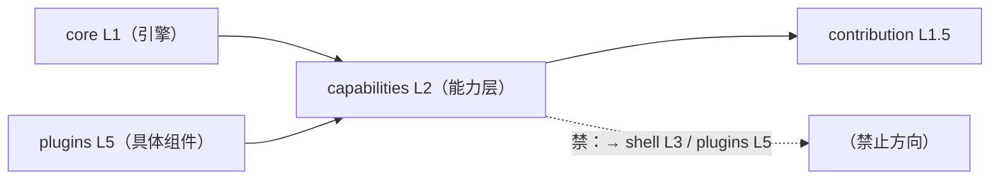
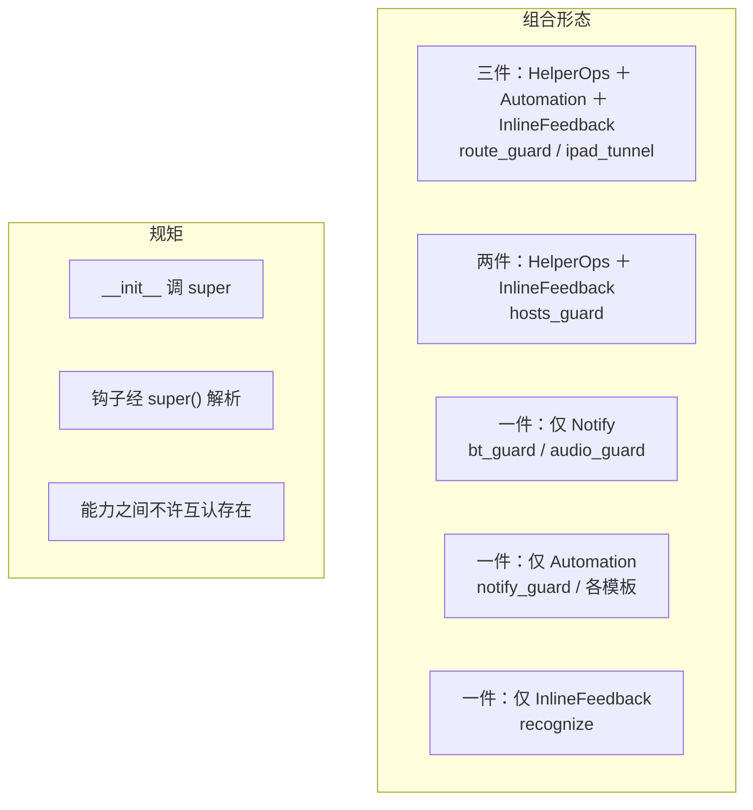

<!-- doc-meta
类型: 架构事实
状态: live
读者: 选能力基类 / 加新能力
关联: [组件契约规范.md, 插件结构规范-基类与样板.md]
-->

# 能力目录

**本文定位**：能力层（L2）**有什么、每个能力替你做了什么、你的插件该继承哪个、组合有什么规矩**。
一句边界：**写**「框架能给你的可选本事」，**不写**某个插件自己的领域逻辑（那在
[组件契约规范.md](组件契约规范.md)）、不写 UI 观感（[设计令牌.md](../guides/设计令牌.md)）、
不写 helper 那个独立进程内部怎么干活（[插件结构规范.md](插件结构规范.md) §8）。

## 1. 术语与边界

> **本节结论**：能力是一个可继承的 mixin，IS-A `Plugin`，插件「需要什么继承什么」。
> 全文只用「能力」这一个名字，不换「插件基类」「横切服务」等别名。

| 术语 | 本文口径 | 落点 |
| --- | --- | --- |
| 能力（Capability） | `capabilities/` 下**能继承**的类，`IS-A Plugin` | `src/barkit/capabilities/__init__.py:1` |
| 能力层（L2） | 与 `core`(L1) / `shell`(L3) / `plugins`(L5) 并列的横切层 | `src/barkit/capabilities/__init__.py:3-5` |
| 抽象钩子 | 子类**必须**实现 —— 框架不知道你那行的领域细节 | 见第 3.2 节 |
| 统一提供 | 框架给的，子类**别重写** | 见第 3.2 节 |
| 协作式 mixin | `__init__` 必须 `super().__init__(ctx)`，钩子用 `super()` 解析 | 见第 4 节 |

**能力不等于服务**：能力是你能**继承**的东西（IS-A），不是你能**调用**的东西（HAS-A）。
判据：看它能不能进 `class Plugin(...)` 的基类括号里。这一条把 `capabilities/notify.py:99`
那台 `NotificationHub`（真·服务，靠 `ctx.notify` 注入）挡在目录外面。

## 2. 能力层的三条硬约束

> **本节结论**：能力不得碰 UI、不得 import 上层、不得带第三方依赖。三条都有门禁，
> 坏一条是**测试红**，不是 review 意见。

| 约束 | 门禁（`tests/test_architecture.py`） | 违反会长什么样 |
| --- | --- | --- |
| L2 不得 import L3/L5（不许引 `barkit.shell` / `barkit.plugins`） | `UPPER_LAYER_BANS` 表 `:121-124` ＋ `test_layer_dependency_direction_upper_layers` `:138` | 能力里一 import 界面库，整棵 `capabilities/` 在插件加载前就炸 |
| `capabilities/` 全树（**含 `helper/` 子树**）模块级零第三方 import | `test_capabilities_lazy` `:212` | 冒出一个 PySide6，说明插件业务渗回了横切层 |
| import 完整棵 `capabilities/` 后 `sys.modules` 里无 Qt / objc 桥 | `test_capabilities_import_pulls_no_heavy_dependency` `:231` | 冷启动变慢，且 mac 桥被拉进守护进程 |

图下一步：能力在依赖图上的位置 —— 它只往下指 `contribution`，**往上不许指任何层**。
上层的东西要能力产出，走的是「能力只产出纯数据（`ModeBadgeSpec` / `NotificationRequest`），
由框架决定怎么画」（`capabilities/__init__.py:10-12`）。

| 图元 | 说明 |
| --- | --- |
| `core`/`capabilities` → `contribution` | 能力产出的规格对象进声明流，由框架渲染 |
| `plugins → capabilities` | 唯一合法的上行边：你继承它 |
| 虚线「禁」 | `test_architecture.py:138` 抓的就是这条 |

## 3. 能力目录

> **本节结论**：现在**四个**能力。选之前先看第 3.3 节的消费方 —— 别人这么选通常有原因。

### 3.1 能力总览

| 能力 | 定义位置 | 它管哪一件事 | 什么时候用它 |
| --- | --- | --- | --- |
| `AutomationCapability` | `capabilities/automation.py:33` | 自动化运行态开关 ＋ 状态行里那枚「自动/手动」徽标 | 你的组件有「自动运行 / 手动接管」这个概念 |
| `HelperOpsCapability` | `capabilities/helper_ops.py:59` | 装同一个 root helper 的三件事（立即重跑 / 安装 / 卸载）＋ 设置页**页尾**那块运维卡 | 你的组件装同一个 root 守护装置 |
| `NotifyCapability` | `capabilities/notify.py:198` | 弹一条系统通知，按钮回来由框架按归属查回投 | 组件要在面板收起时把一句话送到用户眼前 |
| `InlineFeedbackCapability` | `capabilities/inline_feedback.py:39` | 设置页**页首**那条行内反馈槽的接线 ＋ 三档出口（成功 / 中性告知 / 失败） | 组件的设置页要把一句话说给用户 |

各能力**边界只到自己的关注点为止**：`AutomationCapability` 不管整个状态行（领域开关由插件
自己贡献），`HelperOpsCapability` 不认识任何插件（动作与文案都是子类给的），
`NotifyCapability` 不含真弹窗（macOS 那半在 `shell/`，经 `ctx.notify` 注入）。

### 3.2 你必须实现什么 / 框架给你什么

| 能力 | 抽象钩子（必须实现） | 框架统一提供 |
| --- | --- | --- |
| `AutomationCapability` | `automation_active` `:38`、`set_automation_active` `:43` | `toggle_automation` `:57`、`mode_badge_spec` `:66`、徽标渲染与状态自同步 |
| `HelperOpsCapability` | `helper_notice` `:77`、`on_helper_change` `:87`、`helper_ops_texts` `:97` | `immediate_check` `:103`、`install_action` `:133`、`uninstall_action` `:154`、`attach_helper_ops` `:183`（页尾反馈槽） |
| `NotifyCapability` | `on_notification_action` `:224` | `notify` `:208`、`NotificationHub` `:99`、后端挑选 `:187`、两枚按钮上限 |
| `InlineFeedbackCapability` | **无** —— 继承即得那条槽与三档出口 | `attach_feedback` `:56`、`_forget_feedback` `:67`、`_say_info` `:78`、`_say_hint` `:84`、`_say_error` `:94`、槽销毁自动摘引用 |

三条容易反着记的表：

- **`AutomationCapability`**：钩子是**一问一答**的——`automation_active` 是属性不是方法，
  你只回答「现在是不是自动」；写盘失败这类「点了界面却没动静」才用 `set_automation_active`
  返回 `ActionResult`。
- **`NotifyCapability`**：说要弹什么的是你（`NotificationRequest` `:49`），真弹是我们；
  但**按钮回来那条钩子是你实现**的（`:224`），因为那是几小时后、现场早变了，框架只负责把
  「是谁的哪条通知、哪个按钮」查出来投回你（`notify.py:165` 的 `_on_action`）。
  所以它的抽象钩子**只有一个**，别照着另两个能力去补一个「弹通知」钩子。
- **`InlineFeedbackCapability`**：四个能力里**唯一没有抽象钩子**的一个 —— 继承就完了。
  三档出口（`_say_info` / `_say_hint` / `_say_error`）是**给你调**的，不是等你实现；
  要说什么由你的领域决定。别为它补一个「有话说时」的钩子（那只是把 `_say_*` 换个名字）。

### 3.3 谁在用（消费方矩阵）

| 插件 | 继承的能力 | 落点 |
| --- | --- | --- |
| `route_guard` | `HelperOps` ＋ `Automation` ＋ `InlineFeedback` | `plugins/route_guard/plugin.py:124-126` |
| `ipad_tunnel` | `HelperOps` ＋ `Automation` ＋ `InlineFeedback` | `plugins/ipad_tunnel/plugin.py:112-114` |
| `hosts_guard` | `HelperOps` ＋ `InlineFeedback`（**不带** `Automation`） | `plugins/hosts_guard/plugin.py:86` |
| `bt_guard` | 仅 `Notify` | `plugins/bt_guard/plugin.py:188` |
| `audio_guard` | 仅 `Notify` | `plugins/audio_guard/plugin.py:126` |
| `notify_guard` | `Automation`（＋一串插件私有 mixin） | `plugins/notify_guard/plugin.py:63` |
| `recognize` | 仅 `InlineFeedback` | `plugins/recognize/plugin.py:40` |
| 生成骨架（模板出口） | `Automation` | `scaffold.py:302` |
| 内置模板 `plugin_daemon` | `Automation` | `plugins/_template/plugin_daemon.py:99` |
| 外部插件模板（测试夹具） | `Automation` | `tests/fixtures/external-plugin-template/plugin.py:48` |

图下三步解释：① 七个真插件有**五种组合**（四个能力彼此正交，组合数随能力数自然增长）；
② 四个能力之间不互相 import，所以基类括号里谁先谁后都一样；
③ `hosts_guard` 不带 `Automation` 不是疏漏——它是常驻 daemon、没有「手动接管」语义
（`automation.py:5-6` 拿它当反证）。

## 4. 组合规矩（协作式 mixin）

> **本节结论**：三条 —— `__init__` 调 `super()`、钩子经 `super()` 解析、能力之间不许互认存在。
> 破任一条都表现为「MRO 报不出属性」或「改了一个能力，另一个静默失效」。

| 规矩 | 长什么样 | 落点 |
| --- | --- | --- |
| 协作初始化 | `def __init__(self, ctx): super().__init__(ctx)` | `automation.py:53-55`、`helper_ops.py:67`、`notify.py:205` |
| 钩子走 super | 子类同名钩子挂在链上，不是互相覆盖 | 三个能力的类 docstring 各写一遍 |
| 顺序无关 | 能力之间零 import，基类括号里谁先谁后都一样 | `plugins/ipad_tunnel/plugin.py:116-119` 自陈 |

一条**只在一个地方成立**的细节：`hosts_guard` 基类括号里**只写能力**、不并列写 `Plugin`
—— 能力自己就继承 `Plugin`，并列写虽然合法，读起来像递归
（`plugins/hosts_guard/plugin.py:86`）。照它抄，别照 `notify_guard` 那一长串抄。

## 5. 加一个新能力要做什么

> **本节结论**：五步，其中第 5 步（登记这张表）最容易漏，漏了别人不知道有这个能力。

| 步 | 做什么 | 落点 |
| --- | --- | --- |
| 1 | `capabilities/` 下加模块，类名 `<Xxx>Capability(Plugin)` | 新模块 |
| 2 | `__init__` 走 `super()`；抽象钩子 `raise NotImplementedError`，消息带自己类名 | `automation.py:41` 是样板 |
| 3 | 零 UI 依赖、零第三方 import（第 2 节三条门禁会自己查） | 第 2 节 |
| 4 | 在 `capabilities/__init__.py` 的 docstring 里登记这层现在有几个能力 | `__init__.py:14-19` |
| 5 | 补「混入可被继承且 MRO 安全」的用例 ＋ 在第 3.1 节表加一行 | ROADMAP U3 验收① |

**第 4 个能力 `InlineFeedbackCapability` 是 2026-10-05 照这五步落的**：它收的是
「四个插件各写一遍同名同形的**页首**反馈槽接线」，与 `HelperOpsCapability` 管的**页尾**槽
互补。ROADMAP U3 点名的 `Scheduled`（按计划跑）、`Configurable`（配置自描述）
**都还没做** —— 目录里没有它们，也不该去继承一个不存在的类。

## 6. 不是能力的东西

> **本节结论**：`capabilities/` 下还有别的东西，但它们**不是能力样板**，别照抄。

| 路径 | 它是什么 | 为什么不是能力 |
| --- | --- | --- |
| `capabilities/helper/` | 随包部署到系统域的 **root 侧源码包**，由 `/usr/bin/python3 -m helper` 独立进程跑 | 不 import 任何 barkit 代码（连 `core` 都不），**不可继承** |
| `capabilities/helper_client.py` | 同一台 helper 的 **app 侧客户端**（安装 / 卸载 / 状态 / 版本对账） | 服务代码，靠 import 调用，不进基类括号 |
| `capabilities/notify.py:99` `NotificationHub` | 通知中枢，经 `ctx.notify` 注入 | 服务，不是 mixin |

判据一句话：**它是「能继承的 mixin」还是「服务代码」**——后者一律不进目录。
这条例外在 `capabilities/__init__.py:21-34` 明文写了（唯一一个，含两半）。

## 7. 缺陷

> **本节结论**：三个「照着旧文档写会找错地方」的坑，本批已修两处、留了一处。

| 现象 | 实际原因 | 处理 |
| --- | --- | --- |
| `capabilities/__init__.py:10` 写「现有唯一能力 `AutomationCapability`」 | 后两个能力是补进来的，这句清点没跟着改 | **2026-10-05 已改**为三行清点 |
| 基类选择表还写 `Guard` / `capabilities/guard.py:28` —— 那个文件不存在 | 2026-09-14 改名到 `automation.py`，表没跟 | **2026-10-05 已改**，并指向本文 |
| `notify.py:202` 承诺 `Plugin(NotifyCapability, AutomationCapability)` 能组合 | 真插件里**没有**这个组合（三个带 `Automation` 的都不带 `Notify`，两个带 `Notify` 的都不带 `Automation`） | 注释保留为**待兑现承诺**；判「某组合通不通」只认第 3.3 节有没有真实例 |

## 8. 指针

- 字段定义与声明口径：[组件契约规范.md](组件契约规范.md)
- 基类归属与改名史：[插件结构规范-基类与样板.md](插件结构规范-基类与样板.md)
- 要不要加新能力： U3（能力系统统一）
- 选型实操（继承模板在哪）：[组件开发指南.md](组件开发指南.md) 开头「组件是什么」
