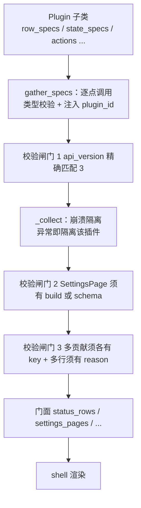

<!-- doc-meta
类型: 操作指南
状态: live
读者: 写插件 / 加扩展点 / 查收集期报错
关联: [设计令牌.md, 验证与自证.md]
-->

> **本文定位**：Barkit 插件能往宿主贡献什么、声明在哪、框架怎么收集、顺序谁定。
> **写什么**：扩展点清单、每个 `Spec` 的字段、排序规则、收集期会拦你什么。
> **不写什么**：状态运行期怎么产出（`StateReport` 只给口径）、UI 配色（见 [设计令牌](设计令牌.md)）、
> 插件怎么打包安装（属能力目录范畴）。本文只到「声明进框架之前」这一段。

## 1. 目的

插件与宿主之间只有一条路：插件在 `Plugin` 子类上写几个具名方法，返回 `Spec` 数据对象，
框架把它们收上来、校验、排序，再交给 `shell` 渲染。缺一张矩阵表时，这件事只能靠读源码反推。
本文就是那张表。

## 2. 核心概念

四件东西，先分清再谈矩阵。

| 概念 | 是什么 | 在哪 |
|---|---|---|
| 扩展点 `point` | 宿主开的一个「位置」字符串，如 `"status.row"` | `src/barkit/contribution/points.py:24-34` |
| 声明点方法 | 插件基类上的具名方法，如 `row_specs()`。一个点一个方法 | `src/barkit/core/plugin.py:390-423` |
| `Spec` | 一个不可变数据对象，描述「挂个什么」，不含行为 | `src/barkit/contribution/specs_*.py` |
| 消费者门面 | `ContributionRegistry` 上的取列表方法，如 `status_rows()` | `src/barkit/core/contributions.py:386-538` |

两条隔离约定必须先记住，否则看代码会以为有两套机制：

- **契约层禁 `PySide6`**：`src/barkit/contribution/` 只依赖标准库，
  门禁 `test_no_pyside6_in_contribution` 守着。`Contribution` 生命周期里的对象只能是数据。
- **插件不碰界面**：`build` 类字段是 `WidgetFactory`（只在类型注解里认识真 `QWidget`），
  插件拿到的回调是 `ActionCallback`，返回值走 `ActionResult` 告诉宿主，**不许自己弹窗**。

**要抄范例就照 `src/barkit/plugins/_template/plugin.py`**：内置模板把
`component()` / `row_specs()` / `state_specs()` / `settings_page()` / `actions()` / `hotkeys()`
六个声明点各写一例，注释里连 `api_version = 3` 为什么须等于 `SUPPORTED_API_VERSION` 都写了。
`detail_entry()` 它没给（那是「开了才有详情面，不开则整行不响应点击」的特殊分支），照现有插件写。

## 3. 运转流程

图上每一步做什么、失败会怎样，逐行如下（位置都是真实落点，改代码时以源码为准）。

| 步 | 位置 | 做什么 | 失败时 |
|---|---|---|---|
| 声明 | `core/plugin.py:390-423` | 你写的方法，`0/1` 点返回 `Spec\|None`，`n` 点返回 tuple | 不写 = 未声明该点，跳过 |
| 收集 | `core/contributions.py:66` `gather_specs` | 按 `declaration_points()` 逐点调用，校验返回类型／元素类型，覆写 `plugin_id` | 装错 `Spec` 类 → `ValueError` |
| 闸门 1 | `core/contributions.py:180` `_validate_plugin` | `api_version == SUPPORTED_API_VERSION`（现为 3）精确匹配 | 过旧／过新都拒，附可读原因 |
| 隔离 | `core/contributions.py:192` `_collect` | 任一声明点抛异常 | 该插件记 `failed`，其余插件不受影响 |
| 闸门 2 | `core/contributions.py:261` | `SettingsPageSpec` 的 `build` 与 `schema` 至少给一个 | `ValueError` → 隔离该插件 |
| 闸门 3 | `core/contributions.py:296` | 同一插件同一声明点有多条 ⇒ `key` 必填且唯一；`StatusRowSpec` 多于一行 ⇒ 每行都要 `reason` | `ValueError` → 隔离该插件 |
| 生成门面 | `core/contributions.py:386-538` | 各点产出 `list[Spec]` | 见第 6 节同级表 |

「隔离」这个词的口径要准：**同一插件不部分生效**。你在 `state_specs()` 里写错一个类型，
`row_specs()` 里写得再对也不会上屏。

## 4. 扩展点矩阵（7 条真通路 + 1 条占位）

`points.py` 声明了 8 个 `POINT_*` 常量，但 `declaration_points()`
（`src/barkit/contribution/points.py:37-69`）只登记了 7 条可收集通路。
最后一行的不一致是真实存在的，不是笔误遗漏的常识 —— 单独标出。

| # | `POINT_*` 常量 | 值 | 声明点方法 | 基数 | `Spec` 类 | 消费者门面 | 声明位置 |
|---|---|---|---|---|---|---|---|
| 1 | `POINT_COMPONENT` | `component` | `component()` | 0/1 | `ComponentSpec` | `components()` | `points.py:33` |
| 2 | `POINT_STATE` | `state` | `state_specs()` | n | `StateSpec` | `states()` / `tray_base_candidates()` / `state_by_id()` | `points.py:32` |
| 3 | `POINT_STATUS_ROW` | `status.row` | `row_specs()` | n | `StatusRowSpec` | `status_rows()` / `panel_rows()` | `points.py:25` |
| 4 | `POINT_DETAIL_ENTRY` | `detail.entry` | `detail_entry()` | 0/1 | `DetailEntrySpec` | `detail_entries()` | `points.py:34` |
| 5 | `POINT_SETTINGS_PAGE` | `settings.page` | `settings_page()` | 0/1 | `SettingsPageSpec` | `settings_pages()` | `points.py:26` |
| 6 | `POINT_PANEL_ACTION` | `panel.action` | `actions()` | n | `ActionSpec` | `primary_actions()` | `points.py:27` |
| 7 | `POINT_HOTKEY` | `hotkey` | `hotkeys()` | n | `HotkeySpec` | `hotkeys()` | `points.py:29` |
| 8 | `POINT_MENU_ITEM` | `menu.item` | **无** | — | `MenuSpec`（仅类型存在） | **无** | `points.py:28` |

第 8 行的现象要讲清楚：`POINT_MENU_ITEM` 只在 `points.py:28` 声明、
在 `contribution/__init__.py:12` 再导出，既不在 `declaration_points()` 表里，
全仓也就没有对应的声明点方法与消费者。**挂不上去**，`MenuSpec` 也没有任何收集路径。
现有插件的菜单项不是走扩展点，是框架自己写死的。

字段不读源码也能查全，按表逐个看（继承 `Contribution` 的都带 `point` / `plugin_id` / `key` / `order`）：

| `Spec` | 自己有的字段 |
|---|---|
| `ComponentSpec` | `icon: IconName`、`name`、`in_header` |
| `StateSpec` | `states: tuple[StateOption,...]`、`icon`、`title`、`initial`、`stale_after`；另有 `state_id` / `topic` 两个 property |
| `StatusRowSpec` | `title`、`mode: ModeBadgeSpec\|None`、`controls: tuple[ControlSpec,...]`、`on_click`、`get_clickable`、`subtitle`、`custom`、`reason` |
| `DetailEntrySpec` | `label`、`icon`、`build`、`presentation`（`popover`／`window`）、`save: FormSaveSpec\|None`、`width` |
| `SettingsPageSpec` | `label`、`schema`、`build`、`reason` |
| `ActionSpec` | `label`、`on_click`、`icon` |
| `HotkeySpec` | `name`、`label`、`default_combo`、`callback` |

**行内控件不是扩展点**。`SwitchSpec` / `ButtonSpec` / `MenuSpec` / `ChoiceSpec`（联合为
`ControlSpec`，`specs_controls.py:110`）不继承 `Contribution`，装在 `StatusRowSpec.controls`
里，随行一起收集，不走声明点，也不参与第 5 节的排序。它们拿到的回调是
`ActionCallback`（`specs_base.py:60`）。

## 5. 优先级与顺序

三个层级各管一段，别指望用一个数字通吃。

| 层级 | 谁定的 | 生效位置 | 作者能做什么 |
|---|---|---|---|
| 插件间 | 配置顶层 `plugin_order` | `_sorted_plugins()`（`contributions.py:353`） | 写在 `Plugin.order`；列进 `plugin_order` 后由用户拖 |
| 插件内 | **你写下的顺序** | 门面按 `_sorted_plugins()` 顺序 extend；`states()` 明确不排序、保序 | 把想优先说的写在前头 |
| 同插件多条 | `Contribution.order` | `registry.collect()`（`registry.py:70`） | 见下方坑表 |

`Contribution.order` 这一层要特别小心：真正在跑的消费者
（`status_rows` / `settings_pages` / `primary_actions` / `hotkeys` / `states` / `components` /
`detail_entries`）**一个都不读 `order`**，全按插件间顺序 + 声明顺序。
读 `order` 的只有 `PointRegistry.collect()`，而 `PointRegistry` 全仓只有测试在注册
（`tests/test_contribution.py:493`）。**照 `order` 填数字，界面不会按它排。**

同理，同一插件声明多台状态机时，代表态平局取**先声明**那台
（`shell/renderers/representative.py`），不存在「填个 priority」这条路 ——
用户侧的覆盖落在 `plugins.<id>.states.<key>.priority`，不在 `StateSpec` 上。

## 6. 收集期会拦你的四件事

按「最容易被撞、撞了最难自查」排。

| 你做的事 | 拦在哪 | 报什么 |
|---|---|---|
| `api_version` 写成 2 或 4 | `core/contributions.py:41` `api_version_reject_reason` | 过旧／过新各一句，附插件 id |
| `SettingsPageSpec` 只给了 `label` | `contributions.py:261` | 没有 `build` 也没有 `schema`，设置页打不开 `TypeError` |
| 同一声明点写了多条却漏了 `key` | `contributions.py:296` | 会撞进同一身份 `<plugin_id>.default`，界面只剩最后一条 |
| 写了多行却漏了 `reason` | `contributions.py:296` | 「面板不是控制台，行数不该随组件内部复杂度增长」 |

顺带说清框架替你补的两类名字（`contributions.py:220` `_fill_identity_defaults`）：

- **身份类**（`StatusRowSpec.title` / `StateSpec.title` / `ComponentSpec.name`）：省略就补 `Plugin.name`，无条件。
- **入口类**（`SettingsPageSpec` / `ActionSpec` / `HotkeySpec` / `DetailEntrySpec` 的 `label`）：
  该声明点**只有一条**时才补；多条时不补 —— 两个按钮各有其事，补同一个名字反而分不清。

补的名字不能等于 `Plugin.name`（门禁 `test_identity_name_is_not_written_twice` 抓）。
图标不在这里补，图标只有一个来源 `ComponentSpec.icon`。

## 7. 状态声明与运行期报告的分界

这条分界是契约口径，写插件时最容易越线。

| | 归谁 | 在哪 |
|---|---|---|
| 静态 | `StateSpec` + `StateOption`（取值闭集、级别、图标、默认文案） | `specs_state.py:85` / `:50` |
| 动态 | `StateReport`：`state`（取值名）+ `summary`（唯一文案）+ `updated_at` | `specs_report.py:14` |

三条硬约束：

1. `StateReport.state` 必须是该 `StateSpec.states` 里声明过的取值名。报未声明的取值，
  框架按 `ERR` 露出（`shell/renderers/state_view.resolve`），不静默吞。
2. 级别和取值图标只写在声明里，运行期不再给 —— 一套取值只允许一个真源。
3. 文案只有 `summary` 一份，同时是面板行副标题、副标题悬停提示、标题栏图标悬停提示；
  它覆盖 `StateOption.text`，留空就用默认。需要「下一步做什么」的引导语，
  请落详情页或行内按钮，**不要塞进 `summary`**。

`StateLevel` 五值：`OK` / `WARN` / `ERR` / `IDLE` / `OFF`（`specs_state.py:21`）。
托盘阈值 `TRAY_MIN_LEVELS` 只有 `WARN` / `ERR` 两档，且 `ERR` 不被阈值拦
（安全不变式）。

## 8. 动作结果怎么回

`ActionOutcome` 只有 `OK` / `FAILED` / `PARTIAL` —— **没有 `pending`**（`specs_outcome.py:22`）。
今天全仓没有一个动作能诚实交出「已派出、结果待定」，硬造一个中间态只会是一张撒谎的表。

`ActionResult`（`outcome` + `text`）只在**有话要说**时返回：
失败但界面看不出来，或只做成了一部分。什么都不返回（`None`）是合法的，
且**成功不必说** —— 开关翻了、窗弹出来了，那就别再写一句「已成功」。

宿主入口有一道规整：`as_action_result`（`specs_outcome.py:69`）把漏出来的
`True`（`Signal.emit` 的返回值）和元组（逗号表达式）挡在门外，记一条 warning 后当「没话说」。
所以 `on_click` 的返回值写错类型不会崩界面，只会静默丢一句反馈。

## 9. 常见坑

| 现象 | 实际原因 | 处理 |
|---|---|---|
| 面板里那一行不随我的 `StatusRowSpec.order` 变 | 消费者门面不读 `order`；`order` 只被未接线的 `PointRegistry` 读 | 靠插件间 `plugin_order` 和声明顺序；见第 5 节 |
| 我在 `state_specs()` 里写错一个类名，整行都不上屏 | 同插件不部分生效：收集期 `ValueError` 隔离该插件 | 看启动日志「插件 X 贡献收集中抛异常」，按 `contributions.py:66` 的报错改 |
| 我声明了两台状态机，`initial` 取的不像我预期 | `initial` 留空取 `states` 的第一个；首屏走的是 property，不是字段 | 显式写 `initial = 取值名` |
| 设置了 `tray.base_source`，菜单栏不认 | 配置项存的是 `StateSpec.state_id`（`{plugin_id}.{key 或 main}`），不是 topic | 用 `state_by_id()` 的反面：读 `specs_state.py:177` 的拼法 |
| 我给 `StateReport` 加了 `level` 字段 | `test_statespec_is_static_only` 守的是 `StateSpec`，但运行期报告里 `level` 无处可取 —— 级别在声明里 | 删掉，让框架回查声明 |
| 想加一枚菜单项 | `POINT_MENU_ITEM` 是占位常量，无声明方法、无消费者 | 现状只能等扩展点接线；别往 `MenuSpec` 上写 |

## 10. 指针

- 配色与组件：第 2 节没展开的取值、几何标尺见 [设计令牌](设计令牌.md)。
- 这份矩阵对应的排期项 S7 在。
- 路线图上 U2（配置与接口统一）与 E4（版本门）的口径在。
- 收口状态与未做项在。
