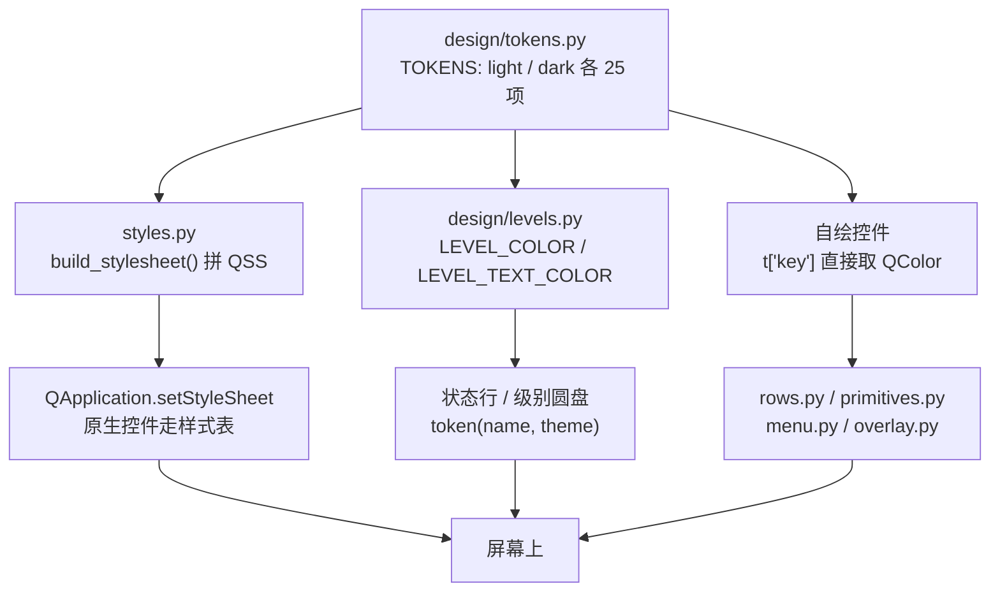
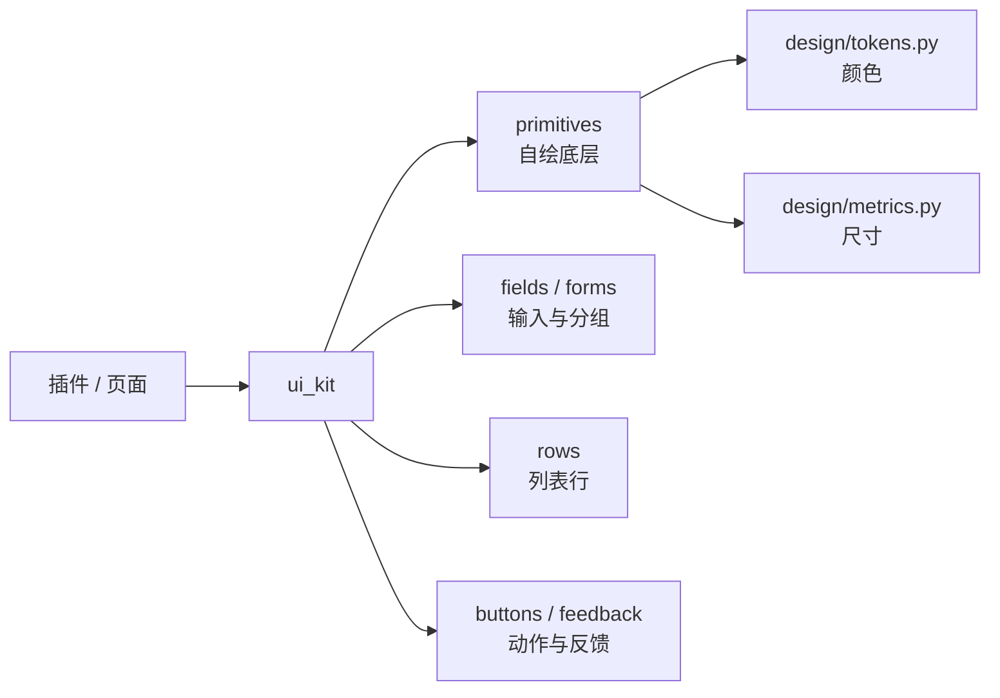

<!-- doc-meta
类型: 操作指南
状态: live
读者: 写界面代码 / 加令牌 / 调样式
关联: [验证与自证.md, 真机验证清单.md]
-->

# 设计令牌与组件目录

本篇只写「**哪个令牌用在哪、怎么取、坑在哪**」。
令牌值本身住 `src/barkit/shell/design/tokens.py`，几何标尺住 `src/barkit/shell/design/metrics.py`。

拆四档的设计理由（为什么一个色相要拆四把钥匙）见。
几何档位为什么只有三档见。

> **不写什么**：不做视觉规范全集，不写按钮该放哪，不记批次进度。
> 找待验条目去。

## 1. 结论

全仓 25 个颜色令牌，两个主题同名同义，取值唯一真源在 `design/tokens.py`：
`shell/styles.py` re-export `TOKENS` 只为兼容旧 import，新代码一律从 `design/tokens.py` 取。
任何业务代码里出现颜色字面量都过不了 `tests/test_no_hardcoded_colors`。

## 2. 核心概念：一个色相四档

同名一个键、每键只有一个角色。拿填充色写字，或拿文字色当底，就是「一符两用」——
2026-09-19 那批 33 格对比度不达标全部由它一个成因造成。

| 档 | 键 | 面上压什么 | 判据 |
| --- | --- | --- | --- |
| 实体档 | `accent` `accent_hover` `red_solid` `red_solid_hover` | `on_solid` 白文字 | 与白 ≥ 4.5 |
| 图形档 | `green` `orange` `red` | 白图形（圆盘字形、开关滑块、行首图标） | 与白 ≥ 3.0 |
| 前景档 | `accent_text` `accent_text_hover` `green_text` `orange_text` `red_text` | 它自己就是文字 / 图标 / 描边 | 与 `surface` / `*_soft` ≥ 4.5 |
| 浅底档 | `accent_soft` `green_soft` `orange_soft` `red_soft` | 只当底 | — |

**术语锁定**：本篇此后「四档」专指上表这四个，不换名。
`design/tokens.py` 的模块 docstring 与本篇是同一张表，改动要同步两边。

## 3. 取令牌的两条路

两条路的差别只有一处：**读的是同一张 dict，写法不同**（见第 6 节第 1 条）。

| 路 | 谁走 | 代码位置 | 写法 |
| --- | --- | --- | --- |
| 样式表路 | 原生控件（按钮、输入框、菜单） | `shell/styles.py:38` 起 | `t['accent']` 单引号，拼进 f-string |
| 自绘路 | `QPainter` 自绘控件与插件 | `shell/ui_kit/primitives.py:306`、`shell/ui_kit/rows.py:106`、`shell/ui_kit/menu.py:115` 等 | `t["accent"]` 双引号，喂 `QColor()` |

`token(name, theme)`（`design/tokens.py:123`）是单点取色口：主题不认识静默回退 `light`，
令牌名写错**当场抛 `KeyError`**（这是故意的，早 fail）。

## 4. 25 个令牌逐条

「用在哪」一列的落点取全仓**第一条**命中，`src/barkit/` 前缀省略。

| 键 | 浅色 | 深色 | 用在哪 | 落点 |
| --- | --- | --- | --- | --- |
| `accent` | `#5E5CE6` | `#6966D5` | 主按钮面、文本选区、`#solid` 图标档 | `ui_kit/rows.py:156` |
| `accent_hover` | `#4F4FD8` | `#5B58C6` | 主按钮 hover | `styles.py:98` |
| `accent_soft` | `#ECECFD` | `#2E2C52` | hover 行底、药丸底 | `ui_kit/primitives.py:306` |
| `accent_text` | `#504EC5` | `#9C9AFF` | 可点文字、选中菜单项 | `ui_kit/menu.py:115` |
| `accent_text_hover` | `#4543AE` | `#B0AEFF` | 药丸按钮 hover 描边与字 | `styles.py:132` |
| `red_solid` | `#C7362C` | `#CE4237` | 危险按钮的面（**不是** `red`） | `styles.py:101` |
| `red_solid_hover` | `#AC2E25` | `#B83B31` | 危险按钮 hover | `styles.py:104` |
| `red` | `#FF3B30` | `#FF453A` | 图形档：错误级圆盘 | `design/levels.py:18` |
| `red_soft` | `#FFE9E7` | `#3A1E1C` | 错误级底、熔断卡底 | `panel/panel.py:237` |
| `red_text` | `#C7362C` | `#FF6B60` | 错误级文字、坏行文字 | `panel/state.py:349` |
| `green` | `#289A45` | `#289A45` | 图形档：正常级圆盘（两主题同值） | `design/levels.py:16` |
| `green_soft` | `#E7F8EC` | `#1D3326` | 正常级底 | `ui_kit/feedback.py:58` |
| `green_text` | `#1E7A41` | `#30D158` | 正常级文字、通过态图标 | `ui_kit/primitives.py:60` |
| `orange` | `#BE7707` | `#BE7707` | 图形档：警告级圆盘（两主题同值） | `design/levels.py:17` |
| `orange_soft` | `#FFF3E0` | `#3A2E12` | 警告级底 | `ui_kit/feedback.py:60` |
| `orange_text` | `#8E5900` | `#FFB340` | 警告级文字 | `ui_kit/primitives.py:60` |
| `on_solid` | `#FFFFFF` | `#FFFFFF` | 实心块上的前景（两主题同值） | `ui_kit/primitives.py:49` |
| `text1` | `#1D1D1F` | `#F5F5F7` | 主文字 | `panel/chrome.py:64` |
| `text2` | `#6E6E73` | `#98989D` | 副文字、无状态级 | `ui_kit/fields.py:108` |
| `text3` | `#8E8E93` | `#6E6E73` | 装饰档：chevron、hint、关闭态圆盘 | `panel/widgets.py:175` |
| `surface` | `#FFFFFF` | `#2A2A2E` | 窗口主面 | `overlay.py:398` |
| `surface2` | `#FAFAFC` | `#242427` | 面板比页面深一档 | `ui_kit/menu.py:111` |
| `surface3` | `#F5F5F7` | `#1F1F22` | 分区标题带、输入框槽 | `panel/widgets.py:120` |
| `border` | `#E4E4E9` | `#3A3A3E` | 1px 描边 | `plugins/todo/clock_view.py:206` |
| `border_strong` | `#D4D4D9` | `#48484C` | 按钮 hover 描边 | `styles.py:87` |

两处**故意**的同值，别当抄错：

- `green` / `orange` / `on_solid` / `red_solid` 在浅深两主题下同值或分叉是有理由的，
  理由写在 `design/tokens.py` 的模块 docstring 第 26–33 行。
- `BRAND_GRADIENT_START` / `BRAND_GRADIENT_END`（`design/tokens.py:118`）**不进 `TOKENS`**：
  `TOKENS` 的语义是「同一个键两套值」，品牌色的定义就是不随主题变，写进两张表等于抄两遍。

## 5. 几何令牌与组件目录

### 5.1 几何标尺

尺寸只有一个真源：`design/metrics.py`。改控件高度 / 圆角 / 间距只改这里。

| 族 | 常量 | 值 |
| --- | --- | --- |
| 按钮档 | `CONTROL_H` / `BTN_ACTION` | 28（行内控件与主动作按钮同一格） |
| | `BTN_INLINE` / `BTN_CHIP` | 22 / 20 |
| 圆角 | `RADIUS_XS` / `SM` / `MD` / `LG` | 6 / 8 / 10 / 14 |
| 间距 | `GAP_XS`…`GAP_LG` | 4 / 6 / 8 / 12 |
| 表单 | `LABEL_W` | 78（标签定宽，各行左缘对齐） |
| 图形槽 | `GLYPH_W` | 18（主图标与取值圆圈共用一列） |

按钮档位名是 `metrics.BUTTON_HEIGHTS` 的键，同时是 QSS 选择器 `[tier=…]` 的值。
改档名要同时改 `metrics.py` 与 `styles.py`，门禁 `test_button_natural_height_fits_its_tier`
逐族逐档量自然高度兜底。

### 5.2 组件目录

`shell/ui_kit/` 是框架给插件与页面共用的控件盒。加控件先问这里有没有。
下表是**索引**（哪个文件住哪族）；每个件的「什么时候用 / 构造签名 / 一行示例」见
[组件盒用法](组件盒用法.md)。

| 文件 | 关键类型 | 一句话职责 |
| --- | --- | --- |
| `primitives.py` | `LogoWidget` `HStatChip` `ElideLabel` `Switch` `ModeBadge` `Card` `Divider` | 自绘底层件与容器 |
| `rows.py` | `HoverRow` `RecordRow` `StatusRow` | 列表行骨架（全仓唯一一份） |
| `fields.py` | `ComboField` `ProfileSelector` `ChoiceSelector` `NumberField` `DecimalField` | 设置页输入格（滚轮只滚页面） |
| `forms.py` | `FormGroup` `form_row` `choice_hint` `settings_section` | 表单与分区卡装配 |
| `buttons.py` | `tool_button` `apply_button_tier` | 建按钮 + 挂档位属性 |
| `feedback.py` | `FeedbackBar` | 行内反馈槽，确认时原位长按钮 |
| `menu.py` | `CandidateMenu` `MenuButton` | 候选弹层与下拉按钮 |
| `editor.py` | `EditorShell` `_EditorNav` | 编辑屏四区外壳与导航带 |
| `editstack.py` | `EditScreen` `EditStack` | 列表屏 ⇄ 编辑屏换屏容器 |
| `results.py` | `present_to_host` `relay_action_result` `clear_layout` | 动作结果回传与布局清理 |
| `base.py` | `glyph_pixmap` `draw_glyph` `apply_text_role` `play_entrance` | 图标与文本角色的通用工具 |

### 5.3 问一句：行内条还是浮层

两个询问出口，**按「谁按出来的」分，不按问句长短分**：

| 出口 | 代码 | 长什么样 | 谁用 |
| --- | --- | --- | --- |
| 行内条 | `ui_kit.FeedbackBar.ask` | 原地长出一行「问句 ＋ 确认 / 取消」，就在刚才那枚按钮下面 | **宿主面**（设置窗 / 详情窗里那些页面） |
| 浮层 | `shell/interaction.PromptOverlay`（经中枢 `ask_now`） | 右上角提示栈里的卡：标题 ＋ 正文 ＋ 可点项 | **插件**（系统到点来打扰你的那种询问） |

**宿主面的确认一律就地（行内），别走浮层** —— 2026-10-16 真机上报后定的：浮层的落点是可用区
右上角、窗口层级 25，而设置窗是 201 且从菜单栏图标下展开后被夹在屏幕右缘 —— **正好盖住右上角
⇒ 确认卡被设置窗挡死**，用户在按钮下面只看到上一轮遗留的旧提示。换「弹屏幕正中」也不是解：
那仍是**另一扇窗**（层级照样低，且认屏跟着光标走，多屏时可能弹到另一块屏上）。两条口径：

1. 有行内槽 ⇒ **就地**问。多行清单也照问：**位置对**比「一条好看的话」重要；
2. 没有槽位（页面已销毁）⇒ 记一条 warning 并**拒绝执行**不可逆动作 —— 没有确认口就等于
  没人确认，宁可不做，也不无声地动一件不可恢复的事。

「取消位也是个真动作」这类（如「保存并关闭 / 放弃改动」）**只能行内**：浮层的退场位就是
「关闭」＝什么都不做，装不下第二个真动作。插件侧那条浮层照旧，两个坑记在这里：**key 每次
必须不重样**（同 key 会被中枢 `_enqueue` 当「正在弹的那条」静默丢掉）、**确认类不设超时**
（`timeout_s=0`，否则等于把不可逆动作悄悄取消，而用户以为自己答过了）。

**别为弹窗新造类型**：浮层就是询问中枢那个 `PromptOverlay`（插件询问走同一个）；宿主面这边
的「确认」就是行内条本身，别再造 `ConfirmSheet`。

**同一张卡里，「问一句」与「报结果」共用那条槽** —— 记着换档：`ask` 问句、`info` 成了、
`hint` 中性告知（**没发生任何事**时用它，如「先勾一项」）、`error` 失败。拿 `info` 去说一件
没发生的事，等于给一个没发生的动作发成功回执（2026-10-16 用户上报的那条）。

### 5.4 反馈五档与确认位的份量

一页里最响的该是**结果**，不是提示 —— 五档各一个色相，选档按「发生了什么」，不按好不好看。
唯一一份实现在 `ui_kit/feedback.py::_TONES`：

| 档 | 什么时候用 | 底 / 左条与图标 / 字 |
| --- | --- | --- |
| `info` | **成了**（已保存、已安装） | `green_soft` / `green` / `green_text` |
| `warn` | 成了、但还差一步 | `orange_soft` / `orange` / `orange_text` |
| `error` | **没成** | `red_soft` / `red` / `red_text` |
| `hint` | 没出错、也还没做成（「先勾一项」） | `surface3` / `text3` / `text1` |
| `ask` | 问句，等回应 | `accent_soft` / `accent` / `accent_text` |

**问句那一档的确认位按「按下去会发生什么」取外观**（`ask(…, confirm_kind=…)`），判据是
**这个动作有没有不可逆后果**：

| `confirm_kind` | 用在哪 | 外观 |
| --- | --- | --- |
| `danger` | 删除 / 卸载 / 清空 / 覆盖 / 恢复默认 / 移除 | 实心红 `red_solid` ＋ 白字 |
| `primary` | 一般确认：两个动作都真、但没有破坏（「保存并关闭 / 放弃改动」） | 实心品牌紫 `accent` ＋ 白字 |
| `ghost`（默认） | 轻量确认，或两个动作本来就没有主次 | 幽灵档：透明底 ＋ 1px 描边 ＋ 灰字 |

**取消位恒为幽灵档**：它是「我不做这件事」，不该跟要执行的那个动作抢注意力。

`#danger` / `#primary` 两族样式**一直在** `styles.py` 里（前者此前只服务面板 / 浮层的
`ButtonSpec.variant`）—— 2026-10-16 之前行内确认位一次也没用过它们，于是「卸载」与它右边的
「取消」长得一模一样。全仓 13 处询问里 **10 处**按下去不可逆。

门禁 `test_destructive_confirm_is_styled_as_danger` 按**确认位文案**里有没有那六个词来判，
扫面是**整个 `src/`**（只扫 `shell/` ＋ `plugins/` 会漏掉 `capabilities/` 里那枚「卸载守护」）。
「放弃」**故意不在词表里** —— 草稿还没落盘，放弃它没有不可恢复的后果，不该升红。

## 6. 常见坑

| 现象 | 实际原因 | 处理方式 |
| --- | --- | --- |
| 搜某个令牌零命中，其实它在用 | 两种写法：`t["key"]`（自绘）与 `t['key']`（`styles.py` 的 QSS f-string） | 两种引号都搜；本次因此误判过 5 个令牌「无消费方」 |
| 标签底下蒙一层白 | `styles.py:45` 的 `QWidget` 是类型选择器，命中 `QLabel` 全部子类，自带 `surface` 实底 | 带底控件走 id 选择器（`pill_*`）或控件自持样式表；`styles.py:63` 的 `QLabel{background:transparent}` 排在 `QWidget` 之后，不许上移 |
| 改了令牌值，对比度断言就红 | `tests/test_shell_design.py` 把 25 格的实测比值写死在断言里 | 改值即改断言，两个一起提交；别删断言改白名单 |
| 深色下按钮像换了牌子 | `red_solid` / `accent` 在深主题下要变深才压得住白字 | 品牌图形另走 `BRAND_GRADIENT_*`，别拿它读 `accent` |
| 确认位与它旁边的「取消」长得一样 | 没给 `confirm_kind`，落回默认的幽灵档 | 不可逆动作（删除 / 卸载 / 清空 / 覆盖 / 恢复 / 移除）必须 `confirm_kind="danger"` |
| 11px 小字读不动 | 用了图形档（`green` 等）写字，图形档只判与白 ≥ 3.0 | 文字一律走前景档（`*_text`） |
| 换肤后自绘控件图标停在旧配色 | 该控件自己没实现 `refresh_theme()`，也没订阅 `theme_changed` | 自绘且吃令牌的控件必须两条都做 |

## 7. 指针

| 要什么 | 去哪 |
| --- | --- |
| 怎么跑检查链、怎么做隔离自证 | `验证与自证.md` |
| 改动要不要上真机目测 | `真机验证清单.md` |
| 颜色字面量收口的来龙去脉 | |
| 四档拆分的实测与判据 | |
| 卡片外观返工（投影删掉那次） | |
| 当前待验条目 | |
